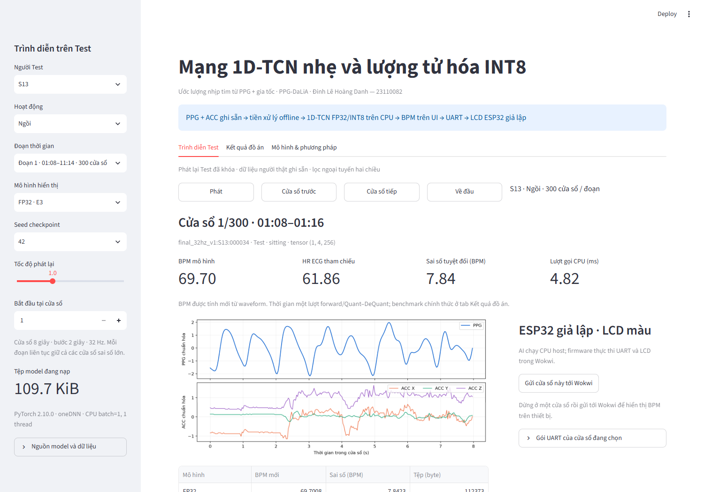

# Ước lượng nhịp tim từ PPG + ACC với 1D-TCN và INT8

Đồ án AI cho IoT: PPG-DaLiA → tiền xử lý tín hiệu → mạng tích chập giãn 1D nhẹ → hồi quy nhịp tim. So sánh FFT, IBI, PPG-only FP32, PPG+ACC FP32 và lượng tử hóa tĩnh INT8. Notebook là phần triển khai thực nghiệm chính; module Python hỗ trợ chạy lại và demo.

## Mã nguồn

```text
DinhLeHoangDanh_DoAn_PPG_DaLiA.ipynb  Notebook dữ liệu, EDA, E0–E4 và kết quả
src/ppg_iot/                          Loader, DSP, model, training/PTQ và metrics
configs/default.toml                 Giao thức và cấu hình thực nghiệm
scripts/                             Tải/chuẩn bị dữ liệu, chạy notebook và kiểm tra
tests/                               Kiểm tra dữ liệu, phương pháp và runtime
demo/                                Streamlit replay với suy luận FP32/INT8 mới
firmware/wokwi_display/               ESP32 UART/LCD trong Wokwi
pyproject.toml / uv.lock              Môi trường CPU có khóa phiên bản
requirements-gpu-base.txt             Dependencies nền cho notebook GPU
requirements-notebook.txt             Kernel và công cụ thực thi notebook
```

Git phân phối mã nguồn, notebook, cấu hình và một bộ nhỏ để xem: [9 model suy luận cuối](models/published/README.md) và [20 file kết quả/biểu đồ/demo chính](results/published/README.md). Các thư mục run/log/checkpoint trung gian, dữ liệu, môi trường và tài liệu cá nhân giữ ngoài Git. Output thực nghiệm trong notebook được bảo toàn.

## Cài đặt và kiểm tra

Yêu cầu Python **3.11**, `uv`, PyTorch **2.10.0**. Chạy tại gốc repo:

```powershell
uv sync --locked --extra demo
uv run --locked --extra demo python scripts/smoke_ptq.py
uv run --locked --extra demo python -m unittest discover -s tests -v
python scripts/export_public_artifacts.py --check
```

Smoke PTQ dùng tensor tổng hợp để kiểm cấu trúc/backend, không xác nhận độ chính xác HR. Cấu hình hiện dùng `onednn`; chuyển runtime/backend cần kiểm lại đường lượng tử hóa.

Trên clone chưa có bundle của run, hai nhóm kiểm tích hợp demo được bỏ qua và ghi rõ `skipped`; các unit test vẫn chạy. Kiểm SHA/byte của bộ published không cần dữ liệu thô. `.gitattributes` giữ nguyên byte của notebook và các file published để checksum không đổi khi Git chuyển xuống dòng trên máy khác.

## Dữ liệu và notebook

Dữ liệu: [PPG-DaLiA tại UCI](https://archive.ics.uci.edu/dataset/495/ppg%2Bdalia). Có thể đặt `PPG_DALIA_DIR` tới thư mục chứa `S1/S1.pkl` … `S15/S15.pkl`; các script tải và kiểm tra dữ liệu nằm trong `scripts/`.

Notebook cần cả `src/`, `configs/` và các file môi trường của repo. Chuẩn bị kernel Python **3.11**, PyTorch **2.10.0** và công cụ notebook bằng:

```powershell
python scripts/setup_accelerator.py
.venv-gpu\Scripts\python.exe -m ipykernel install --user --name ppg-final --display-name "PPG final Python 3.11"
```

Mở [notebook chính](DinhLeHoangDanh_DoAn_PPG_DaLiA.ipynb), chọn kernel này và Run All; hoặc chạy toàn bộ bằng lệnh:

```powershell
.venv-gpu\Scripts\python.exe scripts/execute_notebook.py
```

Training dùng GPU; PTQ và benchmark chạy CPU. Mỗi Run All tạo một workspace mới trong `results/notebook_runs/<id>/`, lưu snapshot source/config/môi trường cùng dữ liệu đã xử lý, model và kết quả. Notebook chính nhận output thật của lần chạy; bằng chứng thực thi nằm trong `results/notebook_executions/<attempt_id>/`. Các run, model và khóa lịch sử ở root được giữ nguyên. Để chạy tiếp một run bị ngắt, dùng `--resume-run <id>`; mã nguồn/cấu hình phải khớp snapshot và workspace chưa được khóa. Run đã hoàn tất phải được tái thực thi bằng một workspace mới.

Trên Colab, đặt đầy đủ mã nguồn trong thư mục làm việc và chuẩn bị Python3.11 bằng `python scripts/setup_accelerator.py`; executable được tạo là `.venv-colab/bin/python`. Dùng executable đó chạy `scripts/execute_notebook.py`. Nhánh Colab có hỗ trợ Drive khi dùng kernel tương thích; việc thực thi trên dịch vụ Colab chưa được kiểm chứng bằng lần chạy laptop.

Giao thức:

- Train S1–S10; Validation S11–S12; Test S13–S15. Không chia ngẫu nhiên các cửa sổ.
- PPG64→32 Hz; ACC32 Hz; cửa sổ8 giây, bước2 giây; đầu vào `(B,4,256)`.
- Lọc liên tục Butterworth0,5–4 Hz/SOS/sosfiltfilt; PPG z-score từng cửa sổ; ACC dùng thống kê Train.
- Ba Conv1d dilation1/2/4, BN/ReLU, pooling, GAP và đầu hồi quy; padding đối xứng.
- Seed42/123/999; chọn checkpoint bằng Validation; calibration INT8 chỉ dùng Train thật.
- ECG/HR là tham chiếu để huấn luyện/đánh giá, không là đầu vào mô hình. Chỉ số chính là MAE macro theo người.

Kết quả chính trong notebook thuộc Run All ngày **05/10/2026**, workspace `20261005T080438565912Z-f1bf0c7c`: E3 **4,816±0,119 BPM**, E4 **4,826±0,127 BPM** (Test macro theo người, mean±sample std, ba seed). Bảng/hình và CPU benchmark tương ứng nằm dưới `results/notebook_runs/<id>/results/`; đường dẫn trong index được tính từ workspace. Theo quyết định người dùng, **đây là kết quả chính của project**; `models/published/` và `results/published/` đã đồng bộ từ cùng run, chọn bằng [primary_run.json](configs/primary_run.json). Bộ gốc04/10 và các workspace/scratch cũ đã chuyển ra ngoài repo; chỉ giữ một run chính cục bộ.

Output nghiên cứu được ghi cục bộ; chỉ whitelist trong `models/published/` và `results/published/` đi vào Git. `python scripts/export_public_artifacts.py` copy/tổng hợp bộ public từ run trong `configs/primary_run.json`; `--run-dir results/notebook_runs/<id>` chọn nguồn rõ ràng. Lệnh không thực hiện thí nghiệm mới. Trên clone, dùng `python scripts/export_public_artifacts.py --check` để kiểm SHA/byte/parent. Không sửa khóa khoa học cũ để nhận một source/run mới là run đã đo.

## Demo có firmware giả lập

```powershell
uv run --locked --extra demo streamlit run demo/app.py --server.address 127.0.0.1
```

Mở **http://127.0.0.1:8501**. UI có chọn Test S13–S15/hoạt động/đoạn/vị trí/seed, phát lại tín hiệu màu, suy luận FP32/INT8 mới, trang kết quả và sơ đồ mô hình. Nút gửi Wokwi truyền BPM vừa tính tới firmware ESP32 và hiển thị ảnh LCD màu từ simulator.

**Clone có model và kết quả chọn lọc, còn cần bộ artifacts đầy đủ để mở demo.** UI dùng registry/đường dẫn gốc, manifest/Train stats, protocol lock, metrics/benchmark và Test bundle cùng run. Khôi phục nguyên cấu trúc từ bộ artifacts đã xuất; dữ liệu thô không cần khi bundle đã có. [Chi tiết demo](demo/README.md), [firmware](firmware/wokwi_display/README.md).

Sau một Run All mới, xuất bundle và chọn chính workspace đó cho UI:

```powershell
uv run --locked --extra demo python scripts/prepare_demo.py --run-dir results/notebook_runs/<id>
$env:PPG_RUN_DIR = "results/notebook_runs/<id>"
uv run --locked --extra demo streamlit run demo/app.py --server.address 127.0.0.1
```

Thay `<id>` bằng tên run đã hoàn tất; khởi động lại server khi đổi run. Khi chưa đặt `PPG_RUN_DIR`, UI dùng run chính trong `configs/primary_run.json`. Model, bundle, kết quả và cache UI được gắn với cùng đường dẫn run. Firmware/toolchain và ảnh LCD vẫn nằm tại source repo. UI mặc định đọc `configs/primary_run.json` và dùng model, Test bundle, metrics và CPU benchmark cùng run chính. Run này đã kiểm918 inference/18 tests/6 ACK và browser thật. Đổi run bằng `PPG_RUN_DIR` chỉ khi đã chuẩn bị bundle tương ứng; không fallback sang kết quả cũ.

AI chạy trên CPU host; firmware giả lập thực hiện UART/parser/LCD. Tiền xử lý là ngoại tuyến hai chiều. Kết quả CPU hoặc emulator không là phép đo latency/điện năng/bộ nhớ AI trên board thật; đề tài ước lượng HR không là hệ thống chẩn đoán lâm sàng.


## Demo đã kiểm và kết quả để xem

Run chính có13.007 Test windows S13–S15, 918 suy luận mới qua6 model E3/E4×3seed;18/18 tests,6/6 ACK/LCD và browser Edge thật đạt. UI nạp đúng SHA model mới, thể hiện E3=4,816±0,119 vàE4=4,826±0,127 BPM. Không train/calibration hoặc chạy lại notebook để cập nhật demo.



[Ảnh trang kết quả](results/published/demo_results.png), [LCD thật từ simulator](results/published/firmware_lcd.png) và [tóm tắt kiểm chứng](results/published/demo_verification.json) nằm cùng20 file public. Các ảnh được chụp từ browser/simulator thực.

Git chỉ phân phối code/notebook/môi trường/cấu hình,9 model và20 kết quả chọn lọc. `.gitignore` chặn data/cache/env/token/Word/PPT/docs cá nhân, log/predictions/raw timing, snapshot và run cục bộ. UI đầy đủ cần bundle/registry/manifest/metrics của run chính; chúng không đi vào Git. Máy nghiên cứu hiện đã có đủ bộ này. Các bản cũ được lưu ngoài repo, không xóa tài liệu nguồn hoặc bằng chứng bất lợi.
