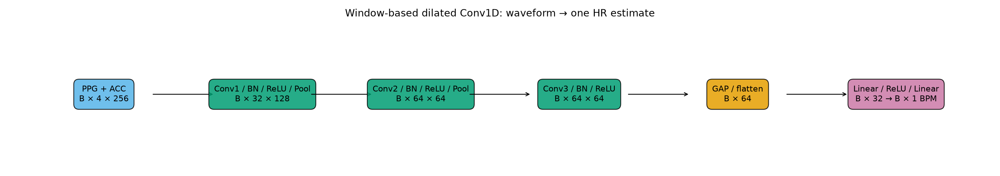
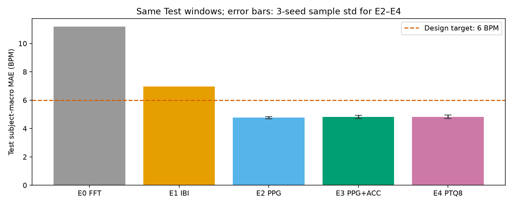
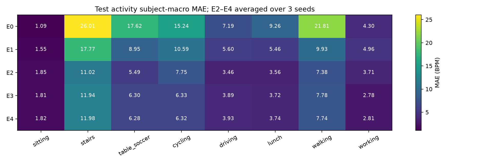

# Kết quả thực nghiệm chọn lọc

**Kết quả chính của project:** Run All gần nhất ngày05/10/2026, workspace `20261005T080438565912Z-f1bf0c7c`, theo quyết định người dùng. PPG-DaLiA với Train S1–S10, Validation S11–S12, Test S13–S15; cửa sổ8 giây/bước2 giây, mạng giãn1D và PTQ tĩnh8 bit;13.007 Test windows mỗi phương pháp/seed. Các bảng/hình được copy từ run đã khóa, không thực hiện đánh giá mới; bộ published cũ đã archive ngoài repo.

| Phương pháp | MAE macro theo người (BPM), mean ± sample std |
|---|---|
| PPG-only FP32/E2 | 4,768 ± 0,080 |
| PPG+ACC FP32/E3 | 4,816 ± 0,119 |
| PPG+ACC INT8/E4 | 4,826 ± 0,127 |

Ba seed42/123/999; std dùng ddof=1. E3/E4 đạt mục tiêu6,0 BPM. Thêm ACC làm MAE trung bình tăng0,048 BPM, dù hai seed cải thiện; không chứng minh khử nhiễu waveform. INT8 nhỏ hơn2,815 lần với ΔMAE trung bình+0,010 BPM; median CPU latency giảm ở cả ba seed, nhưng **mean seed123 chậm hơn FP32** (speedup0,913).

## Bảng và nguồn kiểm tra

- [three_seed_summary.csv](three_seed_summary.csv): MAE/RMSE/tỷ lệ lỗi>10 BPM và std qua seed.
- [activities_test.csv](activities_test.csv): kết quả theo hoạt động Test.
- [test_metrics.json](test_metrics.json): metrics gốc của FFT, IBI, IBI thuần và E2–E4 qua ba seed; gồm macro/pooled, từng người/hoạt động, coverage.
- [model_benchmark.csv](model_benchmark.csv), [paired_benchmark.csv](paired_benchmark.csv): byte và CPU mean/median/p95, tỷ số FP32/INT8.
- [target_status.csv](target_status.csv): đối chiếu mục tiêu với phép đo, giữ cả mục tiêu không đạt.
- [benchmark_runtime.json](benchmark_runtime.json): CPU/runtime/thread/backend và phạm vi DSP ngoại tuyến của phép đo.
- [manifest.json](manifest.json): checksum từng file cùng hash cấu hình, protocol và các index nguồn.

CPU batch1/thread1, warm-up100/1.000 lượt; mạng INT8 gồm Quant/DeQuant, DSP đo riêng. Đây là benchmark host CPU, không là RAM/Flash/năng lượng/latency AI trên MCU. Split ba người Test không là LOSO; chưa xác minh Đ01 cùng giao thức hoặc hiệu quả lâm sàng.

## Các hình chính

[Training history](training_history.png), [Bland–Altman mô tả](errors_bland_altman.png) và [timeline đoạn khó](timeline_hard.png) bổ sung diễn biến/sai số. Các cửa sổ chồng lấn làm Bland–Altman có tương quan, không là validation lâm sàng.

Giữ ba trường hợp bất lợi: [E3 lỗi lớn nhất](failure_largest_E3_error.png), [ACC làm lỗi tăng nhiều nhất](failure_largest_ACC_minus_PPG_error.png), [INT8 làm lỗi tăng nhiều nhất](failure_largest_INT8_minus_FP32_error.png). Không chọn hình chỉ dựa vào dự đoán tốt. **Đính chính đơn vị:** đường PPG trong các ảnh failure case lưu từ Run All là PPG đã lọc/hạ mẫu theo đơn vị nguồn, dù nhãn ảnh ghi “PPG z-score”; PPG đầu vào mạng vẫn z-score từng cửa sổ. Ảnh được giữ nguyên.

Các hình/bảng được copy từ output thực nghiệm. Log, predictions từng cửa sổ, cache, raw timing và các thư mục run vẫn giữ cục bộ. [Model tương ứng](../../models/published/README.md); kiểm checksum bằng `python scripts/export_public_artifacts.py --check`.

## Demo với đúng model của kết quả chính

[Trang kết quả hiện tại](demo_results.png) đọc metrics/CPU benchmark cùng run. [LCD Wokwi màu](firmware_lcd.png) hiển thị BPM vừa suy luận từ model INT8 mới. [demo_verification.json](demo_verification.json) ghi đủ13.007 Test windows,918 fresh CPU inference/18 tests/6 ACK và browser đã kiểm. Firmware thực hiện UART/LCD; AI chạy trên host CPU.

Bộ public có9 model và20 result files:16 kết quả nghiên cứu,3 ảnh demo thực và1 tóm tắt kiểm chứng. Raw signal bundle, predictions/timing/log/run đầy đủ giữ ngoài Git. Không cần archive/data nguồn để kiểm checksum bằng `python scripts/export_public_artifacts.py --check`.
